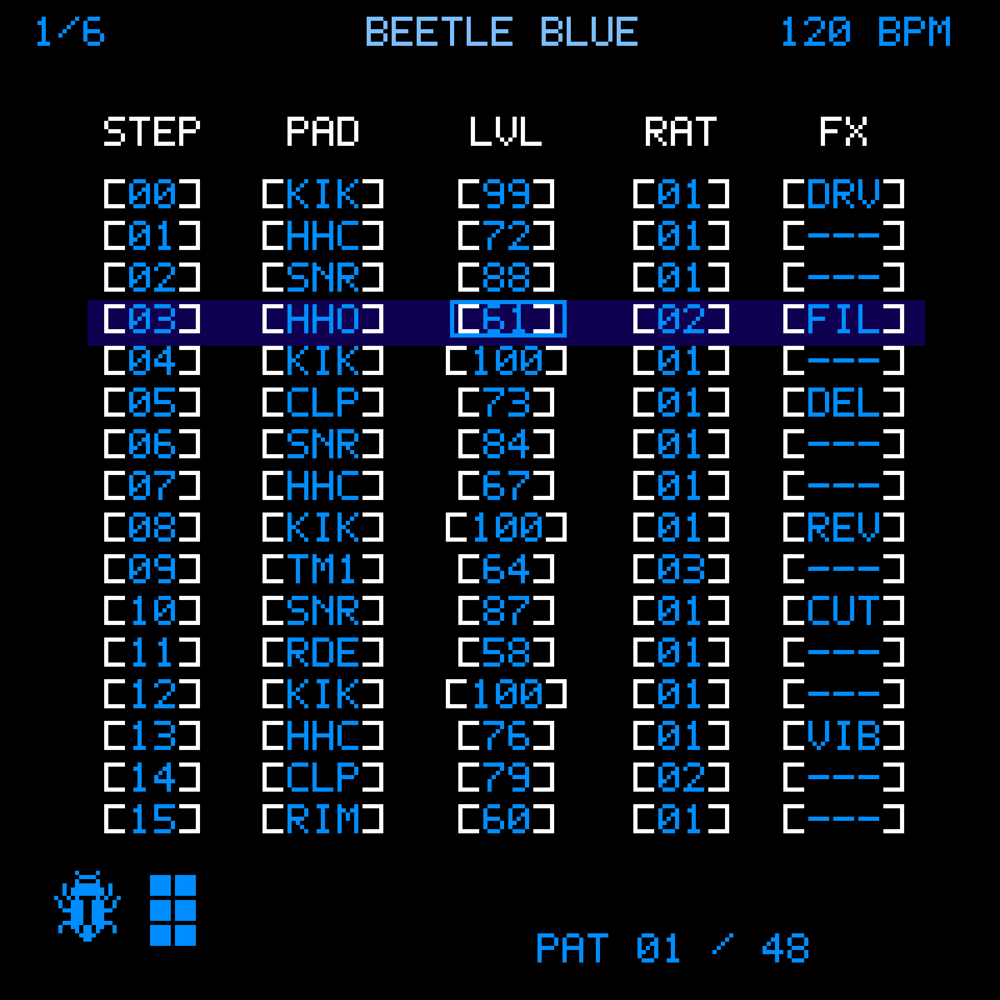

<p align="center">
  
</p>

<h1 align="center">BEETLE BLUE</h1>
<p align="center">
  <strong>An open-source, six-channel drum tracker and sample-based music workstation for the M-VAVE FM1.</strong><br>
  SikkenWorks · Born out of passion.
</p>

<p align="center">
  <a href="BEETLE-BLUE-V0.8-FM1-EXPERIMENTAL.fwsc"></a>
  <a href="web/BEETLE-BLUE-V0.8-Project-Manager.html"></a>
  <a href="UI-SCREENS-1920x1920/"></a>
  <a href="CHANGELOG.md"></a>
</p>

<p align="center">
  <sub>Development release: <strong>V0.8 EXPERIMENTAL</strong> · <a href="CHANGELOG.md">Release history</a> · <a href="validation/V0.8-RESULTS.md">Software validation</a></sub>
</p>

> **Experimental firmware.** The supplied `.fwsc` is a genuine software-built native firmware container, **not a hardware-certified release**. Physical FM1 flashing, audio peak safety, NOR flash endurance, USB recording and OTA recovery have not been verified. Use a dedicated test device only after confirming an independent recovery method and making backups.

---

<h2 align="center">A DRUM MACHINE. A TRACKER. A POCKET-SIZED WORKSTATION.</h2>
<p align="center">
  <strong>Build beats across six dedicated drum channels, design your own kits, sequence songs and perform with live effects.</strong><br>
  <sub>Made for the M-VAVE FM1, with a blue pixel-art interface and hands-on hardware controls.</sub>
</p>

## What is BEETLE BLUE?

**BEETLE BLUE** is a drum-focused fork of [BEETLE](https://github.com/SikkenWorks/BEETLE), developed for the **M-VAVE FM1**. Rather than using BEETLE's five synthesizer lanes and one drum lane, BLUE is designed around **six drum channels** and a kit-based workflow.

| Feature | BEETLE BLUE V0.8 |
| :-- | :-- |
| **Drum channels** | Six sequencer lanes for drum patterns |
| **Patterns** | 48 patterns, with up to 16 steps per pattern |
| **Song arrangement** | 64 song-chain positions with pattern sequencing |
| **Drum sounds** | 14 factory ROM components plus 13 global user-sample slots, U01–U13 |
| **Factory kit variations** | 12 starting timbre kits, selectable from DRUM EDIT |
| **Kit Designer** | 2 fixed source choices and 12 global, user-stored drum timbre kit slots |
| **Active kit palette** | Eight `INST 1–8` assignments stored per project |
| **Sample editing** | Start, end, ADSR, gain, drive and choke controls for user-sample drum components |
| **Performance** | Lane mixer, drum component mixer, Punch-In FX, snapshots and mute groups |
| **Projects** | 12 device project slots; `BDR1` V29; encrypted `.bdrum` backups |
| **USB audio** | Existing experimental stereo / six-stem USB-C capture code |

The drum engine, live performance features, project handling and USB code descend from **BEETLE V1.7.14**. BLUE's native drum-specific features are described below. A successful compilation or Web/host simulation must not be mistaken for real FM1 verification.

## Where to Start

1. **Open the tracker:** press **SEQ**.
2. **Select a drum channel:** rotate **SELECT** to choose CH1–CH6.
3. **Choose a pattern:** rotate **ALGORITHM** to select a pattern from 01–48 while stopped.
4. **Navigate the pattern:** use **K1** to select a step, **K2** to select a field and **K3** to edit its value.
5. **Enter drum hits:** use the FM1 keyboard with tracker recording enabled. The built-in drum IDs and uploaded samples are part of the drum note range.
6. **Set your tempo:** rotate **K4** in the tracker, then press **PLAY/STOP** to audition the pattern.
7. **Shape your kit:** press **EDIT** to open DRUM EDIT, where you can adjust the selected component. With playback stopped, use **K4** to select one of the 12 factory timbre kits.
8. **Open Kit Designer:** from **DRUM EDIT**, press **EDIT** again. Choose one of eight active `INST` assignments and its source kit. Press **SEQ** to return to the tracker.
9. **Arrange and save:** press **ARP** for Song Chains and **SAVE** or **HOME** for project management. Make a computer backup before updating firmware or changing storage.

> **Control terminology:** **SELECT** is the rotary encoder; **SEL** is its push-button. The same controls may have different roles on different screens.

## Kit Designer: the Three Different Kit Concepts

BLUE distinguishes between **factory drum timbre variations**, **global saved kit sources**, and **active per-project kit assignments**. They are not interchangeable.

| Concept | Count | Where it lives | What it contains |
| :-- | --: | :-- | :-- |
| Factory timbre variations | 12 | Firmware | Different starting settings for the 14 ROM drum components; selected with K4 in DRUM EDIT |
| Fixed Kit Designer sources | 2 | Firmware / global sample bank | Source `0` = BEETLE ROM; source `1` = MONOLITH routing, which requires separately uploaded WAVs |
| Global user kit sources | 12 | Storage V2 `BBK1` metadata | Saved drum **timbre parameters** for 14 components, not copies of WAV data |
| Active kit assignments (`INST 1–8`) | 8 | Current `.bdrum` project | References to source IDs 0–13; a primary tracker step's INST field chooses one assignment |

### Kit Designer controls

From **DRUM EDIT**, press **EDIT** to open **KIT DESIGNER**.

| FM1 control | Function |
| :-- | :-- |
| **K1** | Choose active assignment `INST 1–8` |
| **K3** | Choose its source: `BEETLE ROM`, `MONOLITH` or `USER KIT 01–12` |
| **SEL** | Store the current 14 factory-component timbre settings into the selected global USER KIT source; only while stopped and with valid Storage V2 |
| **EDIT** | Return to DRUM EDIT |
| **SEQ** | Return to the tracker |

A **global user kit** stores Attack, Decay, Sustain, Release, Gain, Pitch, Drive and Choke values for all 14 factory components. Those presets can be referenced by multiple projects, but **their audio is still sourced from the ROM instruments**. A user kit is **not** a custom multi-WAV drum kit. Changing a kit source in the project's palette marks the project as modified; **SAVE** the project to retain the assignment.

**Important limitation:** V0.8 applies the project kit palette to **primary tracker drum steps**. The inherited CH6 secondary/third drum hits do **not** yet independently follow those palette assignments. Do not assume every subhit changes kit with its primary step.

### How global kits are stored

The 12 global user timbre presets use a CRC-checked `BBK1` footer in the existing **Storage V2 metadata**, with alternating index-generation commits. Saving them is guarded by storage ownership checks and a stopped audio engine; an invalid or unavailable V2 volume causes the write to be refused.

These presets are **not included** in ordinary `.bdrum` project backups, and the supplied V0.8 Project Manager **cannot export the separate BBK1 kit bank**. A firmware downgrade, older storage writer, destructive format or storage migration may lose it. Record important settings outside the device until a dedicated kit-bank backup workflow is available.

## MONOLITH Default Sample Kit

The included [`assets/MONOLITH-Kit/`](assets/MONOLITH-Kit/) directory contains **16 source WAV files**. Flashing the firmware does **not** install those WAVs on the FM1. BLUE currently supports **13 global user-sample slots** (`U01–U13`), so the supplied MONOLITH mapping uses 13 samples; three WAVs remain available as optional replacements.

| FM1 global slot | MONOLITH WAV | Drum component |
| :-- | :-- | :-- |
| U01 | `kick.wav` | KIK |
| U02 | `snare_1.wav` | SNR |
| U03 | `hihat_1.wav` | HHC |
| U04 | `open_hihat.wav` | HHO |
| U05 | `tom_1.wav` | TM1 |
| U06 | `tom_2.wav` | TM2 |
| U07 | `tom_3.wav` | TM3 |
| U08 | `crash.wav` | CRS |
| U09 | `ride.wav` | RDE |
| U10 | `clap.wav` | CLP |
| U11 | `perc_1.wav` | PC1 |
| U12 | `perc_2.wav` | PC2 |
| U13 | `perc_3.wav` | PC3 |

**Additional WAVs:** `rim.wav`, `snare_2.wav` and `hihat_2.wav`. The default RIM component uses its ROM sound. See the [complete mapping](assets/MONOLITH-Kit/MONOLITH-FM1-SLOT-MAP.json).

To use MONOLITH routing, upload the mapped WAVs into the corresponding **global** U-slots using the V0.8 Project Manager, verify device storage, then choose **MONOLITH** as a Kit Designer source. Any component without its corresponding stored sample uses the factory ROM fallback where implemented. The FM1's shared flash capacity limits total stored sample duration; the 13 slots do not guarantee a particular number of seconds.

**Asset rights:** these 16 WAVs came from the supplied project assets. Their rights for public redistribution have **not** been independently established. Confirm permission before publishing the WAV files in a public GitHub repository.

## Drum Editing and Sample Editing

**DRUM EDIT** works with factory drum components and user samples. The inherited settings include tone-shaping and kit character controls; BLUE adds project-saved sample trim and envelope parameters.

| User-sample parameter | Function |
| :-- | :-- |
| **START** | Start position, 0–99% |
| **END** | End position, 1–100%; must be greater than START |
| **ATTACK / DECAY / SUSTAIN / RELEASE** | Four envelope parameters, each 0–100 |
| **GAIN** | Playback level |
| **DRIVE** | Drive amount |
| **CHOKE** | Choke-group assignment |

The native BD4S streamed-sample path seeks to the required prefetch block, starts at the trimmed position and ends with a short anti-click fade. The separate project-local µ-law sample path also supports trimming. The selected settings are serialized with the project's **BDR1 V29** data; they do **not** embed the original WAV into every project.

## FM1 Controls

### Main navigation

| Button / encoder | Main use in BLUE |
| :-- | :-- |
| **SEQ** | Open or return to the tracker; modifier for existing editing shortcuts |
| **SELECT (rotary)** | Select a drum channel in the tracker |
| **ALGORITHM** | Select pattern 01–48 in the tracker |
| **K1** | Tracker row; kit assignment or component selection in relevant editors |
| **K2** | Tracker column or parameter field |
| **K3** | Edit a focused parameter or kit source |
| **K4** | Tracker tempo; factory kit variation in DRUM EDIT when stopped |
| **SEL (push)** | Confirm contextual actions; store a global USER KIT from Kit Designer |
| **EDIT** | DRUM EDIT; press again for Kit Designer; press again to go back |
| **GLO** | Regular lane mixer → component DRUM MIXER → tracker |
| **FX** | Step effects and Punch-In performance pages |
| **LFO** | Master effects |
| **ARP** | Song Chains |
| **PLAY/STOP** | Transport playback |
| **REC** | Contextual note-entry or Punch-In recording |
| **HOME / SAVE** | Projects and save operations |

### Lane Mixer versus Drum Mixer

- **Lane Mixer:** press **GLO** for CH1–CH6 lane-level controls, including level, pan and mute/solo behavior.
- **Drum Mixer:** press **GLO again** to open component-level controls for the factory drums and global user-sample components. **K1** chooses a component, **K2** chooses a field, and **K3** adjusts `GAIN`, `PITCH` (where supported), `DRIVE` or `CHOKE`.
- Press **GLO** again to return to the tracker. Component edits affect the project's drum settings; save the project to keep them.

### Pattern and performance tools

BLUE retains BEETLE's pattern editing, step dynamics/groove, Song Chains, mixer, Punch-In FX, snapshots and mute-group code paths. Some inherited CH6-specific editing behavior is not yet generalized to every drum lane. The source and on-device screens are the authority for contextual shortcuts; the **V0.2 Web Prototype is not a V0.8 simulator**.

## Projects, Backups and Compatibility

- BLUE uses **12 project slots** with a separate **`BDR1`** project identity to prevent ordinary BEETLE `TRK1` projects from being treated as all-drum projects.
- V0.8 **writes BDR1 V29**. The decoder has migration paths for older BLUE V26–V28 project data; dedicated V28 fixture coverage is still missing in the new V0.8 tests.
- The current Project Manager uses encrypted **`.bdrum`** project backups; the global WAV library uses **`.beetlebank`**. Save both when working with custom samples.
- **Global user kit presets (`BBK1`) are a third, separate storage category.** The current Manager cannot export them. A `.bdrum` or `.beetlebank` export is not a complete backup of BLUE's global kit presets.
- Do not assume that ordinary **`.beetle` / `TRK1`** project files are directly interchangeable with **`.bdrum` / `BDR1`** files. Maintain backups before switching between BEETLE and BEETLE BLUE.
- Storage V2 migration or provisioning is potentially destructive. Do not run it without a verified backup of all projects and sample data. Do not interrupt power during flash operations.

### Project Manager

The current browser tool is [`web/BEETLE-BLUE-V0.8-Project-Manager.html`](web/BEETLE-BLUE-V0.8-Project-Manager.html). Its code is included in this source release; a publicly hosted BLUE-specific GitHub Pages URL has **not** been verified for V0.8. Host it over HTTPS in a compatible browser where required for USB-MIDI access, and confirm device identity before writing.

It supports the inherited project and global-sample workflows, including encrypted project backups and the U01–U13 sample bank. The tool is V29-aware, but it **does not read, export or restore BBK1 global user-kit presets**. Some inherited controls and labels may still use the original BEETLE wording.

## USB-C Audio Recording (experimental)

The source retains the BEETLE USB Audio Class capture configuration: a stereo master path or **six separate mono stems at 44.1 kHz / 16-bit**, depending on the supported device configuration. This is **FM1 → computer audio**, not USB screen capture or computer-to-FM1 playback.

Six-stem USB audio, host enumeration, clock stability, channel routing and long recordings are **not validated on physical FM1 hardware** for BLUE V0.8. Do not rely on it for irreplaceable recording sessions. No new USB-audio feature is claimed by the V0.8 kit update.

## Installation and Safety

1. Keep an independently verified backup of projects (`.bdrum`) and original global WAVs (`.beetlebank`); record any important global kit parameters separately.
2. Verify you have a **working independent FM1 firmware recovery procedure** before attempting any experimental flash.
3. Review [V0.8 software validation](validation/V0.8-RESULTS.md) and check the `.fwsc` SHA-256 if using the supplied file.
4. Treat the provided firmware as **experimental**, not a safe one-click upgrade. Avoid using headphones, powered monitors or amplifiers for unmeasured audio-output testing.
5. Do not erase or reformat shared Storage V2 data merely because an older firmware cannot interpret BLUE's `BBK1` or `BDR1` data.

The archive contains **no validated V0.8 WebInstaller**. The included [`web/BEETLE-DRUM-V0.2-WebPrototype.html`](web/BEETLE-DRUM-V0.2-WebPrototype.html) is an **older prototype**, not a firmware-accurate V0.8 WebSimulator. The [UI gallery](UI-SCREENS-1920x1920/) comprises nearest-neighbor enlarged **reference/mockup PNGs**, not captures from a physical FM1 LCD.

## Development and Source Layout

| Location | Contents |
| :-- | :-- |
| `firmware/fm1-native/` | Native FM1 tracker, drum/DSP, UI, project, Storage V2 and USB source |
| `assets/MONOLITH-Kit/` | Sixteen source WAVs and 13-slot import map (check redistribution rights) |
| `web/` | V0.8 Project Manager and historical V0.2 web prototype |
| `tests/` | Native host/unit/regression test sources and scripts |
| `validation/V0.8-RESULTS.md` | V0.8 software-verification results and known limitations |
| `UI-SCREENS-1920x1920/` | 42 UI reference images and two boot-frame PNGs, enlarged from 240 × 240 |
| `docs/` | Credits, licence information and the preserved upstream BEETLE documentation |
| `CHANGELOG.md` | BLUE release-specific changes and validation limitations |

### Build from Source

Use the separately obtained compatible **JieLi Linux toolchain**. The compiler/toolchain is not bundled in this source release.

```bash
export JIELI_TOOLCHAIN=/path/to/jieli-linux-toolchains-20260730.1
python firmware/fm1-native/build.py --drum-edition --beetle-storage-lab --beetle-v2 --updater --usb-audio
python tools/package_beetle_blue_v08.py
```

The distributed V0.8 native application is **523,420 bytes** and the experimental `.fwsc` container is **610,086 bytes**, as recorded in [`validation/V0.8-RESULTS.md`](validation/V0.8-RESULTS.md). These figures describe a successful software build, **not** available CPU time, physical safety or installed-device behavior.

The [CHANGELOG](CHANGELOG.md) is the release log. This README is the operating and technical guide, not a running list of version-by-version fixes.

## Support

When reporting a bug, include the BLUE firmware version, exact FM1 screen and controls used, steps to reproduce, whether Storage V2 is active, and whether user WAVs or global kit presets were involved. Keep personal projects and full flash dumps private unless you have deliberately removed sensitive content. Separate confirmed hardware observations from simulator or host-test observations.

---

## Credits and Licences

**BEETLE BLUE** is developed by **SikkenWorks (Joppe Sikken)** as a drum-focused derivative of BEETLE. It is **not a clean-room firmware** and retains upstream source and notices. The distributed native firmware is under **GNU GPL-3.0-only**. See [`LICENSE`](LICENSE), [`LICENSES/`](LICENSES/) and [`docs/CREDITS-AND-LICENSES.md`](docs/CREDITS-AND-LICENSES.md).

| Project / contributor | Attribution |
| :-- | :-- |
| **[BEETLE](https://github.com/SikkenWorks/BEETLE)** · SikkenWorks | Source base for the six-lane tracker, sequencer, performance tools, Storage V2, DSP, USB and OTA integration. V0.8 BLUE is based on the BEETLE V1.7.14 lineage. |
| **[Felucca](https://github.com/hugelton/Felucca)** · Leo Kuroshita / Hügelton Instruments | Original FM1 hardware abstractions, LCD/input, startup and audio/OTA foundations, GPL-3.0-only. See [`LICENSES/FELUCCA-LICENSING.txt`](LICENSES/FELUCCA-LICENSING.txt). |
| **[ETCH](https://github.com/SikkenWorks/ETCH)** · SikkenWorks | Earlier FM1 firmware and part of the protected firmware/OTA packaging lineage. |
| **JieLi Technology** | FM1 target-chip and toolchain manufacturer; applicable third-party notices remain in effect. |
| **reSID** · Dag Lem | SID-emulator technical attribution preserved from upstream BEETLE. BLUE does not claim to embed the original reSID library. |
| **Nes_Snd_Emu** · Shay Green (blargg); James Athey | NES audio technical-reference attribution preserved from upstream. The original upstream C++ emulator is not claimed to be part of BLUE. |

The bundled MONOLITH WAV files have **unverified third-party redistribution rights** and should only be published where the rights holder has authorized distribution. Preserve all applicable source-level notices and original attributions. Distribution of firmware binaries should be accompanied by the corresponding source required by the GPL.

<p align="center"><strong>BEETLE BLUE · SikkenWorks · Born out of passion.</strong></p>
